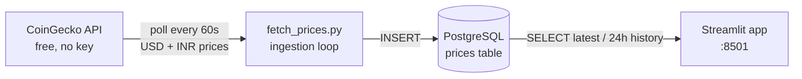

# Live Crypto Dashboard

A real-time crypto price pipeline: prices stream from the free **CoinGecko API** into **PostgreSQL** every 60 seconds, and a **Streamlit** dashboard serves them live with auto-refreshing price cards and 24h trend charts. Everything ships in **Docker** — one command spins up the database, the ingestor, and the dashboard.

## Key Features

- 🔄 **Continuous ingestion** — scheduled poller hits CoinGecko's public API every 60s and writes USD + INR prices and 24h change % to Postgres
- 📊 **Live Streamlit dashboard** — price cards with 24h change deltas, per-coin 24h trend charts (Plotly), auto-refresh every 60s
- 🗄️ **Time-series storage** — append-only `prices` table with a `(coin, fetched_at)` index for fast latest-quote and history lookups
- ⚙️ **Fully configurable** — tracked coins, poll interval, and refresh rate all via environment variables (see `.env.example`)
- 🐳 **One-command deploy** — Docker Compose wires up Postgres + fetcher + dashboard with health-checked startup

## Architecture



## Tech Stack

| Layer | Technology |
|---|---|
| Ingestion | Python 3.11, `requests` (CoinGecko REST API) |
| Storage | PostgreSQL 16 (`psycopg2`), indexed time-series table |
| Dashboard | Streamlit, Plotly, pandas |
| Config | `python-dotenv` / environment variables |
| Infra | Docker + Docker Compose |

## Prerequisites

- [Docker](https://docs.docker.com/get-docker/) with the Compose plugin
- That's it — no API keys needed (CoinGecko's public tier is keyless)

## Run It

```bash
cp .env.example .env     # optional: tweak coins or intervals
docker compose up --build
```

Open **http://localhost:8501** — the first prices land in Postgres within a
minute and the dashboard starts refreshing on its own.

To stop: `docker compose down` (add `-v` to wipe the stored price history).

### Run without Docker (app only)

Point the dashboard at an existing Postgres:

```bash
pip install -r requirements.txt
cp .env.example .env        # set POSTGRES_* to your database
python src/fetch_prices.py  # in one terminal
streamlit run src/app.py    # in another → http://localhost:8501
```

## Configuration

All settings are read from the environment — see [`.env.example`](.env.example) for placeholders:

| Variable | Default | What it does |
|---|---|---|
| `POSTGRES_HOST` / `PORT` / `DB` / `USER` / `PASSWORD` | `localhost`/`5432`/`crypto` | Database connection (Compose overrides host with `db`) |
| `COINS` | `bitcoin,ethereum,solana` | Comma-separated CoinGecko coin ids to track |
| `FETCH_INTERVAL_SEC` | `60` | How often the fetcher polls CoinGecko |
| `DASHBOARD_REFRESH_SEC` | `60` | How often the dashboard refreshes |

## Project Structure

```
live-crypto-dashboard/
├── src/
│   ├── config.py         # env-based settings
│   ├── db.py             # schema, inserts, latest/history queries
│   ├── fetch_prices.py   # polling loop: CoinGecko API → Postgres
│   └── app.py            # Streamlit dashboard
├── Dockerfile
├── docker-compose.yml    # db + fetcher + dashboard in one command
├── requirements.txt
├── .env.example          # placeholder values only — copy to .env
├── .gitignore
└── README.md
```

## Screenshots

> TODO (Abhishek): add your screenshots here — a full-page capture of the dashboard with live prices, and one of a 24h trend chart.

## Make It Yours

- **Swap the data source** — point `fetch_prices.py` at any JSON API (Open-Meteo weather/AQI needs no key either). Keep the `insert_prices()` contract and nothing else changes.
- **Add alerts** — e.g. ping yourself when BTC moves >2% in an hour; the 24h-change column is already stored.
- **Track more coins** — just extend `COINS`; history starts accumulating immediately.

---

All data is public (CoinGecko API). Built to demonstrate an end-to-end data pipeline: API ingestion → relational storage → live analytics UI, containerized for reproducibility.
